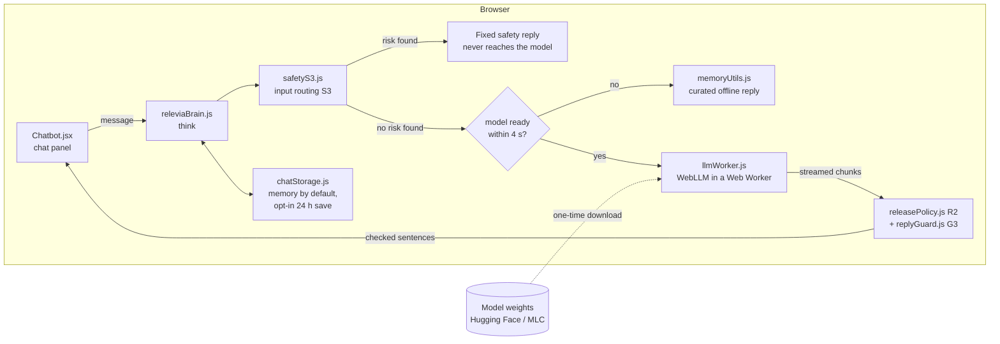

# Relevia architecture

This document describes how Relevia is built today and the steps that led to it. Each step names the problem it was solving. The work is agent-assisted, and I review every change. Measurements and evaluation live in the separate research repository; this document only describes the software.

## 1. The shape of the app

Relevia is a single-page React app (React 18, Vite 6, Tailwind 3, React Router 7). It has no backend of its own. The language model runs inside the visitor's browser through WebLLM and WebGPU, so the text of a conversation is not sent to an inference provider.

The diagram does not show three other network flows:

- the one-time model download;
- Vercel Analytics on the hosted site;
- the browser's own speech services, which are used only when speech is switched on.

## 2. What each part does

| Area | Files | Job |
|---|---|---|
| Pages | `src/pages/*.jsx`, `src/components/CopingTechniques/*.jsx` | Home, About, Coping (seven techniques), Medication, Resources and Contact. Pages are lazy-loaded in `App.jsx`. |
| Chat UI | `src/components/Chatbot.jsx`, `ChatPrivacy.jsx` | The chat panel, voice controls, and the history and privacy controls. |
| Orchestration | `src/services/releviaBrain.js` | `think()` runs one turn: it routes the message, waits a bounded time for the model, builds the prompt, streams, guards and stores. It also picks the model tier for the device and reports engine status. |
| Model | `modelConfig.js`, `llmWorker.js` | Model tiers: Llama 3.2 3B, Llama 3.2 1B and Qwen 2.5 0.5B, in q4f16 or q4f32. The worker keeps generation off the page's main thread. `CUSTOM_MODEL` is the only place a fine-tuned model would plug in. |
| Input routing | `safetyS3.js` (current); `safety.js` (S2, frozen) | Deterministic rules applied to the user's message before any inference. Messages about an act already taken, or with the means at hand, get a fixed emergency reply. These rules are not a clinical classifier. |
| Output checking | `replyGuard.js` (G3) | Checks what the model wrote. It replaces inappropriate refusals, keeps refusals to give harmful information, and removes service names or numbers it cannot verify. |
| Streaming release | `releasePolicy.js`, `responseTiming.js` | Decide how much of a partly written reply may be on screen (R0–R3; the app uses R2, finished checked sentences), and record when text actually appears. |
| Fallback | `memoryUtils.js` | Tone detection and curated replies used when the model is not ready or fails. |
| Storage | `chatStorage.js`, `db.js` | A per-session store held in memory. Saving is opt-in and kept for 24 hours. Crisis context switches saving off for the session. |
| Home letter | `personalLetter.js` | Optional non-clinical content. It never reads chat history. |
| Research harness | `browserBenchmark.js` | An opt-in benchmark with its own engine and synthetic input. It is not connected to the chat. |
| Look | `tailwind.config.js`, `src/index.css`, `src/components/Crayon.jsx` | The paper, crayon and pencil design system. See [`design/DESIGN_LOG.md`](design/DESIGN_LOG.md). |
| Privacy tooling | `scripts/privacy_scan.py`, `.githooks/`, CI | Scans for credentials, personal details and model weights before commits and releases. |

## 3. How it got here

Each step below names the problem first, then the change.

1. **The API key could not stay in the browser.**
   - *Problem:* The first chat called a hosted model API (Groq) directly from the frontend. That meant a provider credential lived in browser code, and every conversation went to a third party.
   - *Change:* The integration was retired (`groqApi.js` is now a stub) and inference moved into the browser with WebLLM.
2. **The model was too big for a laptop.**
   - *Problem:* Llama 3.1 8B needed about 6 GB of GPU memory, and the first reply took minutes.
   - *Change:* I moved to smaller tiers (`modelConfig.js`), chosen automatically per device. I also cut the context window to 1,536 tokens and capped replies at 110 tokens.
3. **Nobody should wait for a download.**
   - *Problem:* The first message on a new device waited for a download of more than a gigabyte.
   - *Change:* `think()` now waits at most 4 seconds (`READY_WAIT_MS`), then answers with a curated offline reply while the model keeps loading.
4. **The page froze while the model ran.**
   - *Problem:* WebLLM ran on the main thread, which blocked scrolling and typing.
   - *Change:* It now runs in a Web Worker (`llmWorker.js`) with the same API.
5. **The LoRA adapter was never actually used.**
   - *Problem:* An earlier `LORA_URL` setting pointed at an adapter, but WebLLM cannot load a LoRA at runtime.
   - *Change:* The setting was removed. A fine-tuned model would now be exported as a whole WebLLM model and set in `CUSTOM_MODEL`, and only after it beats the plain model in a side-by-side check.
6. **One conversation leaked into the next (Milestone 2).**
   - *Problem:* Chat history was shared and persistent, so a new session could inherit another conversation. Sensitive records could also stay on disk.
   - *Change:* `chatStorage.js` keeps each session in memory. Saving is an explicit choice, kept for 24 hours. Delete also tries to remove the old shared database and reports if it is blocked.
7. **The safety checks missed things.**
   - *Problem:* The original single regular expression (S0) missed risk cases and raised false alarms.
   - *Change:* S2 (`safety.js`) added normalised text and context. It is now frozen and hash-recorded for comparison. S3 (`safetyS3.js`, Milestone 4.1) fixed the misses found on held-out data, and added a fixed emergency path that never reaches the model.
8. **Checking the user's message was not enough (Milestones 4 to 4.1).**
   - *Problem:* A real chat showed the model refusing to talk about a death and giving out-of-date US crisis numbers.
   - *Change:* `replyGuard.js` now checks the model's own words. G2 checked the reply while it streamed. G3 goes further and shows only finished, checked sentences, because a fragment such as "Child" could become "Childline" one word later.
9. **Showing whole sentences costs latency.**
   - *Problem:* Holding text back until a sentence is finished means the visitor sees nothing for longer.
   - *Change:* `releasePolicy.js` separates *when* text may be shown from *what* is wrong with it, so the research repository can replay the same recorded stream through four policies (R0 immediate, R1 whole reply, R2 sentences, R3 prefix-safe). `responseTiming.js` records when text actually appears, which separates "the model is slow" from "the guard is holding text". The app stays on R2 until the study is done.
10. **Private details could slip into commits.**
    - *Change:* I added a privacy scan with a pre-commit hook, a release check, and CI with read-only permissions. Fonts are now bundled rather than loaded from Google Fonts, so visiting the site makes no font request.
11. **The interface did not suit its purpose (November 2026).**
    - *Problem:* The gradient, glass and motion-heavy interface did not fit a calm support tool.
    - *Change:* I replaced it with a paper-journal structure, crayon drawings and a pencil-written chat. [`design/DESIGN_LOG.md`](design/DESIGN_LOG.md) records the mockups and the decision.

## 4. Deployment

- `npm run build` produces a static site in `dist/` with Brotli and gzip copies of each file.
- Pushing `main` deploys the hosted site on Vercel.
- `npm run deploy` builds with `--mode pages` for GitHub Pages under `/relevia/`. `public/404.html` and `main.jsx` restore deep links there.
- There is no server-side state. Everything a visitor saves stays in their own browser profile.

## 5. Known limits

- The browser behaviour of these cases has not been tested end to end:
  - a reload during generation;
  - two open tabs;
  - deleting a chat while a reply is being written;
  - switching models;
  - a network failure;
  - losing the GPU.
- The routing rules and the reply guard are deterministic checks. They are not validated clinical safety systems, and the emergency wording still needs review by a qualified person.
- Saved chats are not encrypted, and anyone sharing the browser profile can open them.
- The quality of replies has not been rated independently.
